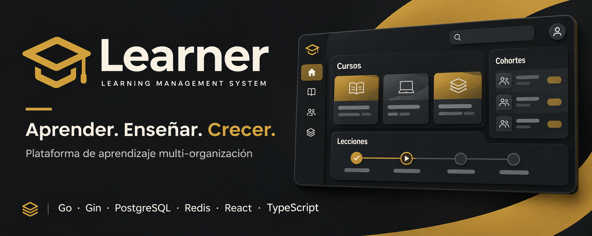

# Learner — documentación

Esta carpeta reúne la página de GitHub Pages y documentación de producto y técnica.
La guía de desarrollo y puesta en marcha está en el [README principal](../README.md).

## Documentos

- [Página del proyecto](index.html) — landing estática publicada en GitHub Pages.
- [Alcance del producto](product.md) — funcionalidades, personas, permisos y trabajo pendiente.
- [Arquitectura](architecture.md) — capas y organización del backend.
- [Referencia de arquitectura](architecture-reference.md) — decisiones y compromisos actuales.
- [DDD, arquitectura hexagonal y SOLID](solid-ddd-hexagonal.md) — principios y criterios de diseño.

## Publicación

GitHub Actions publica el contenido de esta carpeta en
[venturaproject.github.io/stack-learner](https://venturaproject.github.io/stack-learner/).
El workflow se ejecuta al actualizar `doc/` en `main` o manualmente desde la pestaña
Actions del repositorio.
